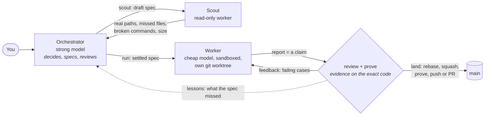
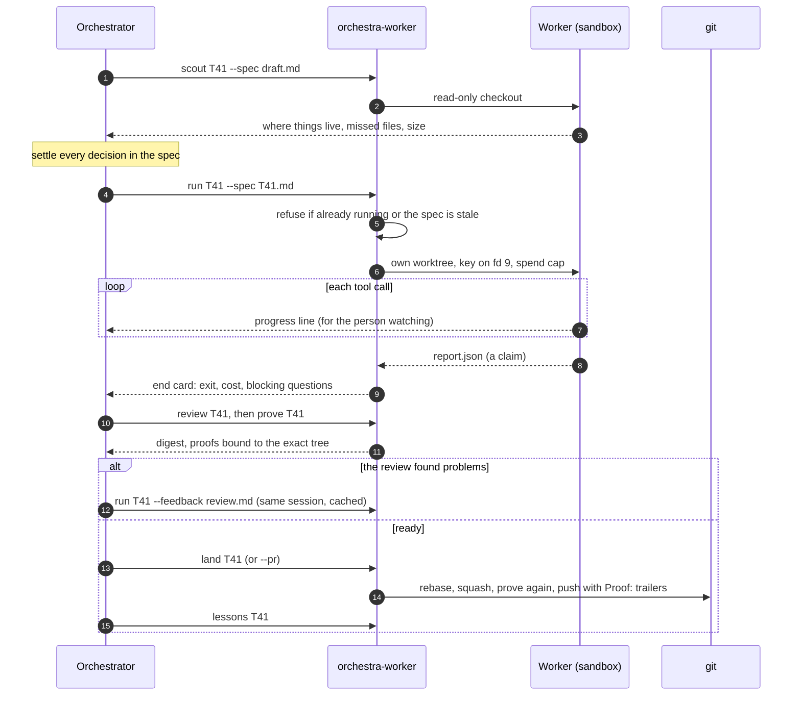
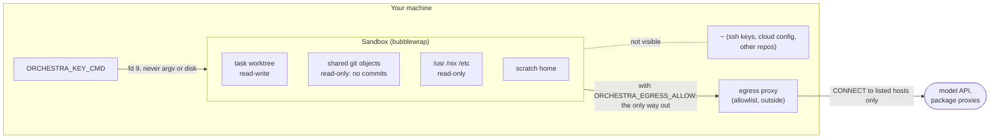
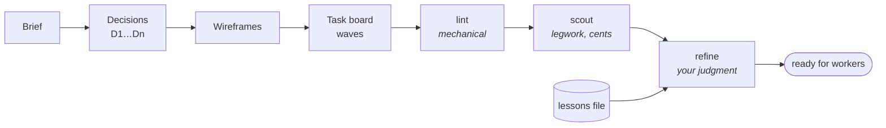

# orchestra

**A strong model decides. Cheap models type.**

orchestra lets an orchestrating agent (Claude Code, pi, Codex, opencode, or you) hand well-specified coding tasks to
cheap, fast worker models running in a sandbox, then review what they did before anything lands. The orchestrator
keeps every judgment call (design, data rules, edge cases, the tests that pin them); workers implement the settled
remainder and report back. A typical task costs a few cents of worker time.



- **Model-agnostic workers**: any provider and model your harness supports (DeepSeek, OpenAI, Anthropic, Qwen via
  OpenRouter, local Ollama, …). One model per run, enforced from the event log.
- **Harness-pluggable**: [pi](https://github.com/earendil-works/pi) today; adding another is three bash functions.
- **Orchestrator-agnostic**: a plain-markdown [orchestrator guide](docs/orchestrator-guide.md) any agent can follow,
  plus ready [Claude Code skills](skills/claude-code/) and [pi tools](examples/pi/orchestra.ts).
- **Sandboxed** (bubblewrap): a worker sees its own git worktree and nothing else from your home. It cannot commit
  or push. Its API key arrives on a file descriptor, never on a command line or on disk. Optionally it can reach
  only the hosts you list.
- **Built for a budget**: a spend cap per run, a ledger of every task's cost, and a review flow designed to keep the
  expensive model's tokens for decisions ([Develop on a budget](#develop-on-a-budget)).

## Real numbers
- **19 production runs on 18 tasks** of a privacy-sensitive web app (Go, Postgres, templates): **$1.25 in total** on
  DeepSeek Flash. Median **$0.063** per run, cheapest $0.023, most expensive $0.125 (a 28-file task that should have
  been split).
- The first of them: redaction rules plus 40 table-driven tests, two rounds, **$0.15**. The orchestrator's review
  caught two privacy bugs the worker's own tests missed; they went back as required test cases and were fixed in
  round two. That review step is the point of the design.
- orchestra builds itself: versions 0.5 to 0.7 were written largely by its own workers, about **$0.05 per task**.
  A scout checking a draft spec: **$0.026**, about a minute.

## Quick start
Requirements: Linux with [bubblewrap](https://github.com/containers/bubblewrap), `git`, `python3`, coreutils
`timeout`, and a harness ([pi](https://github.com/earendil-works/pi)).

```sh
git clone https://github.com/bismigel/orchestra && cd orchestra
./install.sh                             # links the CLI into ~/.local/bin and the Claude Code skills (--ops: ops too)
$EDITOR ~/.config/orchestra/config.env   # the worker model, how to fetch its key, a spend cap
orchestra-worker doctor                  # checks sandbox, harness, key (never printed), model, base, gate
tests/all.sh                             # offline self-tests (no model calls)
```

Minimal config (`~/.config/orchestra/config.env`):
```sh
ORCHESTRA_MODEL=deepseek/deepseek-flash
ORCHESTRA_ALLOWED_MODELS=deepseek/deepseek-flash
ORCHESTRA_KEY_ENV=DEEPSEEK_API_KEY
ORCHESTRA_KEY_CMD='pass show api/deepseek-workers'   # any command that prints the key
ORCHESTRA_MAX_COST=0.50                              # stop any run that spends more (exit 5)
```
See [config/config.example.env](config/config.example.env) for other providers, local models, dev environments
(`nix print-dev-env`, `mise`), cache mounts, the network allowlist and per-repository settings.

Try it on the bundled example (cost: well under one cent):
```sh
cd your-repo
orchestra-worker run hello --spec /path/to/orchestra/examples/hello/spec.md
orchestra-worker review hello
```

## How you use it
1. **Classify** the task: `worker` (the spec settles everything), `split` (you write the risky rules and test rows
   first), or `orchestrator` (do it yourself). Never delegate judgment calls.
2. **Write the spec**: goal, allowed paths, decisions, acceptance the worker can run, out of scope. For anything
   beyond a few files, **scout** the draft first: `orchestra-worker scout <id> --spec draft.md`.
3. **Launch**: `orchestra-worker run <id> --spec spec.md`, in the background; 2-3 workers at a time.
4. **Review**: `orchestra-worker review <id>` puts it on one screen: how the run ended, **blocking** questions,
   **assumed** calls, files changed outside the spec's paths, the worker's claimed checks, proofs for the exact
   code, and a ranked diff stat (`--json` for editor widgets). Then the diff, your own run of the checks
   (`orchestra-worker prove <id>`), and probes with your own inputs.
5. **Feedback** (`--feedback review.md`, same session) or **land**: `orchestra-worker land <id>` rebases, squashes,
   proves the exact code and pushes with `Proof:` trailers (`--pr` opens a pull request instead, for protected
   branches). A worker's report is a claim; a proof is a check orchestra ran itself ([docs/proofs.md](docs/proofs.md)).
6. **Learn**: `orchestra-worker lessons <id>` drafts lines for the lessons file from what the spec missed;
   `orchestra-worker clean` archives and removes landed worktrees; `orchestra-worker history` shows every task's
   runs, tokens and cost.

One task, end to end:


The full loop is in [docs/orchestrator-guide.md](docs/orchestrator-guide.md); the reasoning in
[docs/design.md](docs/design.md).

## Develop on a budget
Worker tokens are cheap; **the orchestrator's are not**. Every worker run above together cost $1.25, while the
strong model writing the specs and reading the results was the larger share of the spend. So orchestra is built to
spend the expensive model's attention on decisions and review, and to hand everything else to cents-per-task
workers.

| Where money goes | What keeps it small |
|---|---|
| The orchestrator reading code to write a spec | `scout`: a read-only worker finds the real paths, call sites, affected tests and size for about $0.03, and hands back lines to paste |
| The orchestrator reading a run's output | Progress lines are for people. Read only the end card (`sed -n '/^── /,$p'`), or go straight to `review` |
| The orchestrator reading a whole diff | `review` first: blocking questions, files outside the paths, proofs, a ranked diff stat. Open the full diff when the digest says it matters |
| Round two of a task | Feedback continues the same worker session, and providers cache its context: 98% of all worker input tokens were cache reads, and a second round cost less than the first ($0.070 vs $0.101) |
| A looping or confused worker | `ORCHESTRA_MAX_COST` stops the run at your cap (exit 5); `ORCHESTRA_TIMEOUT` bounds the time. Give workers their own API key with a provider-side spend limit |
| Rediscovering the same spec gap | `orchestra-worker lessons` turns what a review found into rules for the lessons file, which `refine` applies to every later spec |
| A task too big for one run | Keep tasks to about 8 files or 400 lines; the scout's size estimate says when to split. The one $0.125 run above was a 28-file task |
| Not knowing what you spent | `orchestra-worker history`: every task's runs, tokens and cost, cleaned-up ones included, with the project total |

Habits that pay off:
- **Do the small decided fix yourself.** A one-line change you have already decided is cheaper to type than to
  specify, launch and review.
- **Run 2-3 workers, not 10.** Your review is the bottleneck, and unreviewed runs are money spent on claims.
- **Plan once, carefully.** `orchestra-plan` front-loads the decisions; tasks that leave no judgment call open come
  back right the first time.
- **Match the orchestrator to the work.** Planning and risky reviews deserve the strongest model you have; routine
  waves of well-specified tasks can be driven by a cheaper orchestrator (pi on a mid-range model, say), because the
  specs, proofs and review digest carry the rigour.
- **Workers can be free.** A local model through Ollama works as a worker for simple tasks (`ORCHESTRA_MODEL=ollama/…`,
  no key); keep the paid model for the rest.

## Seeing what is happening
```
$ orchestra-worker status
TASK     STATE    ELAPSED  RUN  TOOLS    COST  NOW
T41      running  6m12s    1       38  $0.041  edit internal/web/layout.templ
T44      running  2m03s    1       11  $0.012  quiet 2m10s · bash go test ./internal/web/ -run Notice
T39      stale    1h02m    1        -       -  process gone
```
- **While a run works**, its output has one line per tool call (`T41 03:12 #14 edit internal/web/layout.templ`)
  and a `quiet for` line after a minute without one, so a background run's log reads like a progress feed.
- **`orchestra-worker watch`** redraws that table every two seconds with each worker's last actions. Keep it open
  in a terminal next to your agent.
- **When a run ends** it prints a card: exit meaning, time, cost, blocking questions first, then the next command.
- **stale** means the process is gone: never wait on a stale run. `--json` feeds editor widgets
  ([examples/pi/workers.ts](examples/pi/workers.ts) shows each worker's current action in pi).

## What a worker can reach

- Without `ORCHESTRA_EGRESS_ALLOW` the sandbox shares your network (the worker must reach its model API). With it,
  the sandbox has no network but loopback, and its one way out is orchestra's proxy, running outside, which allows
  only the hosts you list and logs every attempt. Details and known gaps: [docs/security.md](docs/security.md).
- Two runs never share a task; stopping `orchestra-worker` stops its worker; a model outside the allowlist fails the
  run (exit 3).

## Planning and refinement
Workers do better work from better specs, so orchestra also helps you write them:
- **`plan`** (skill `orchestra-plan`): a planning session for a new project: brief, numbered decisions, scope and
  MVP line, architecture, HTML wireframes, and a board of worker-ready tasks. Checkpoints you approve; the planning
  pack in the repository is the state. See [docs/planning-guide.md](docs/planning-guide.md) and
  [templates/](templates/).
- **`refine`** (skill `orchestra-refine`): brings tasks up to the definition of ready. Its mechanical half is a CLI
  (`orchestra-task lint`: front matter, ownership overlaps, paths, runnable acceptance, `proof:` lines,
  dependencies, out of scope), the legwork half is the scout, and the judgment half is yours.
- **`scout`**: before a spec is final, `orchestra-worker scout <id> --spec draft.md` sends a read-only worker to
  check it against the code and prints a block to paste into the spec. Cents per task; you keep the decisions.



## Ops profile (infrastructure)
`ORCHESTRA_PROFILE=ops` in a repository's `.orchestra/config.env` is for GitOps infrastructure work: workers get a
stricter prompt (no credentials, validators, rendered-diff report), tasks need `risk` and `rollback`, and two skills
cover it: `ops-change` (one loop for every change, with checklists for new apps, upgrades, backups and secret
rotation) and `ops-incident`. They are installed only with `./install.sh --ops`. See
[docs/ops-guide.md](docs/ops-guide.md).

## Commands
| Command | What it does |
|---|---|
| `orchestra-worker run <id> --spec <file>` | one worker run on one task (`--feedback <file>` for the next round, `--prompt "<text>"` for an ad-hoc task) |
| `orchestra-worker scout <id> --spec <draft>` | read-only check of a draft spec against the code (`--prompt "<text>"`; `--state` for a host-side live snapshot) |
| `orchestra-worker status` / `watch` | what is running now, each worker's current action and cost |
| `orchestra-worker review <id>` | the one-screen digest of a finished run (`--json`) |
| `orchestra-worker diff <id>` | the review diff, generated files in the stat only (`--rendered` diffs `ORCHESTRA_RENDER_CMD` output) |
| `orchestra-worker prove <id>` | the gate and the spec's `proof:` lines, bound to the exact code |
| `orchestra-worker land <id>` | rebase, squash, prove, push with `Proof:` trailers (`--pr` for a pull request) |
| `orchestra-worker lessons <id>` | draft lessons lines from what the spec missed |
| `orchestra-worker artifact <id>` | collect a task's report, diff and proofs as an artifact (`--local`, `--open`) |
| `orchestra-worker clean` / `history` | archive and remove landed worktrees / every task's runs, tokens and cost |
| `orchestra-worker doctor` / `guide <name>` | check the setup / print a guide's path |
| `orchestra-task lint` | the mechanical half of the definition of ready |

Exit codes: `0` ok · `2` refused or misconfigured · `3` a disallowed model answered · `4` no valid report ·
`5` over budget · `124` timed out · `130` stopped.

### Make it the default in Claude Code
`install.sh` installs the skills (`/orchestra`, `/orchestra-land`, `/orchestra-plan`, `/orchestra-refine`). To have every session use
them, add one line to `~/.claude/CLAUDE.md`:
```
- Delegate mechanical coding work with the orchestra skill: I decide and review; workers only implement settled specs.
```
pi: link [examples/pi/orchestra.ts](examples/pi/orchestra.ts) and [examples/pi/workers.ts](examples/pi/workers.ts)
into `~/.pi/agent/extensions/`. The optional virtual model router ([examples/pi/orchestra-router.ts](examples/pi/orchestra-router.ts))
routes each turn by cost and difficulty — `orchestra/ds-auto`, `gemini-auto`, `claude-auto`, and `flash-auto` for workers;
see [docs/router.md](docs/router.md) for the profiles, the frugal thinking levels and the benchmark behind them.
Other orchestrators: reference `docs/orchestrator-guide.md` from their `AGENTS.md`.

## Status
Early and evolving: the commands above, the report schema and the config keys are meant to stay stable while the
inside improves. Planned: more harness adapters ([#3](https://github.com/bismigel/orchestra/issues/3)), macOS
sandboxing, and an optional long-running worker service for unattended queues. Ideas and adapters are welcome.

## Contributing
See [CONTRIBUTING.md](CONTRIBUTING.md). Run `tests/all.sh` before opening a pull request.

## License
[MIT](LICENSE)
